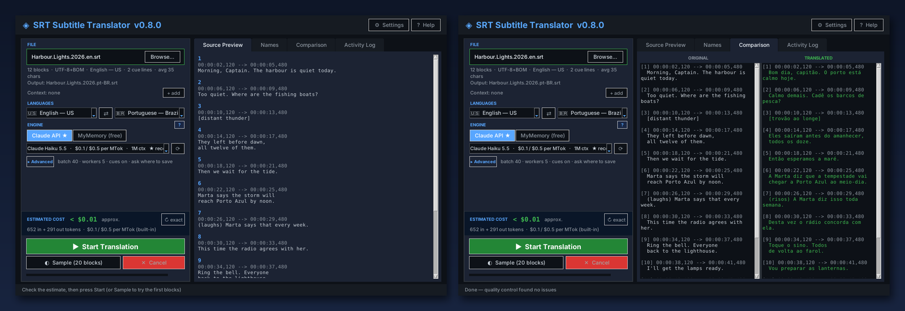

# SRT Translator

**Translate `.srt` subtitle files while keeping timing and structure intact.**

[](LICENSE)  [](https://github.com/junqueirach/srt-translator/actions/workflows/ci.yml) 

<p align="center"></p>

**Download for Windows:** get the latest `SRT-Translator-<version>-win64.zip` (about 26 MB) from the [latest release](https://github.com/junqueirach/srt-translator/releases/latest). Unzip it, open the `SRT Translator` folder and double-click `SRT Translator.exe`. No Python needed. The SHA-256 checksum is in the release notes. For the Claude engine you need your own API key (see Quick start).

> **Windows SmartScreen:** the file is not code-signed, so Windows may show "Windows protected your PC". Click **More info**, then **Run anyway**. You can also run the app from source (see Quick start) and read every line of the code first.

## How it works

<p align="center"></p>

1. Load a `.srt` file (drag and drop or Browse). Encoding and language are detected.
2. Pick the target language, the engine and, for Claude, the model. Everything you need for a run is on one screen; batch size, workers and the cue option sit under **Advanced**.
3. Check the cost estimate above the Start button, optionally run a 20-block **Sample**.
4. Press **Start**. Blocks are translated in parallel batches, checked, repaired if needed and saved as `Movie.pt-BR.srt`. The status line at the bottom always says what to do next.

## What it does

- Two engines: **Claude API** (best quality, bring your own key) and **MyMemory** (free, for testing)
- **Structure-preserving**: cue numbers, timestamps and line counts are never touched, only text is translated
- **Live model list** read from the Anthropic API, newest first, cached for offline use
- **Live pricing** from Anthropic's published pricing page, refreshed daily, plus a local `pricing.json` override
- **Exact cost estimate** using the free `count_tokens` endpoint, and the **real cost** of every run from the API usage
- **Hearing-impaired cues** such as `[door slams]`, `(laughs)` and `APPLAUSE` are translated in their original style (optional)
- **Quality control**: every block is verified after the run; unchanged or lost lines are retranslated automatically and a QC report is shown
- **Name preservation**: a list of people, places and institutions that must stay as written, with an auto-detect button
- Optional **context file**: the same film in another language, sent by time window to help with ambiguous dialogue
- Formatting tags (`<i>`, `<b>`, `{\an8}`) are protected during translation
- Drag-and-drop loading, encoding detection, output folder memory, parallel requests with retry

## Quick start

```
python srt_translator.py
```

The first run offers to install the two packages the app needs (`requests` and `anthropic`) if they are missing. Or install them yourself:

```
pip install -r requirements.txt
```

Optional: `pip install tkinterdnd2` enables drag and drop.

For the Claude engine you need an API key from [console.anthropic.com](https://console.anthropic.com). Enter it in **⚙ Settings** or set the `ANTHROPIC_API_KEY` environment variable. The key is kept in `~/.srt_translator_config.json`, outside this repository, and is sent only to `api.anthropic.com`.

## Using the app

| Step | What to do |
|---|---|
| File | Drop the `.srt` on the box or click Browse. Block count, encoding, detected language, cue lines and the output name are shown underneath. |
| Context | Optional, Claude only: **+ add** a subtitle of the same film in another language. Only the lines around each batch, by timestamp, are sent. |
| Languages | Source is detected from the text; adjust if wrong. Target is remembered. ⇄ swaps them. |
| Engine and model | Toggle **Claude API ★** or **MyMemory (free)**. The model list comes from the API; ★ marks the cheapest current model. ⟳ refreshes models and prices. The **?** explains both engines. |
| Advanced | Batch size (5–60), workers (1–8), *Translate hearing-impaired cues*, and *Save next to the source file* (otherwise a Save dialog opens). The output name is the source name without its language tag plus the target code: `Movie.en.srt` becomes `Movie.pt-BR.srt`. |
| Estimated cost | Shown above Start as soon as a file is loaded. Press **↻ exact** to count the real input tokens. The real cost of each run is written in the Activity Log. |
| Names tab | One name per line. **Auto-detect names** asks Claude to list people, companies and institutions found in the file; review the list before starting. A `Movie.names.txt` next to the subtitle is loaded automatically; **Load from file…** and **Save next to SRT** manage the list. |
| ⚙ Settings | API key, model and price catalog refresh, pricing.json location, settings file location. |
| Sample | Translates the first 20 blocks, shows them in the Comparison tab with the real cost, saves nothing. |
| Start | Translates everything, runs quality control, saves the file and verifies its structure. |

## Quality control

After every run each block is compared with its source:

- text identical to the source (likely untranslated)
- missing or empty lines, lost formatting tags
- names from the preserve list that disappeared

Blocks with the first two kinds of problem are sent back to Claude once, in small groups. Whatever remains is listed in the Activity Log and highlighted in the Comparison tab. A batch whose output was cut off by the token limit is split in half and retried automatically.

## Models and pricing

The app does not hardcode the model list. On start, and whenever you press ↻, it reads `GET /v1/models` and shows every current Claude model with its context size. The list is cached in the config file so the app also opens offline.

Prices are resolved in this order:

1. `pricing.json` next to the app, if present (see `pricing.example.json`)
2. the official pricing page, downloaded once a day and cached
3. a built-in table, used only when both fail

`pricing.json` format, prices in dollars per million tokens, keys are model family and version:

```json
{
  "haiku 5.5":  {"input": 0.10, "output": 0.50},
  "sonnet 5.5": {"input": 2.00, "output": 10.00}
}
```

Typical cost, measured on a 903-block, 90-minute documentary translated to Brazilian Portuguese with Claude Haiku 5.5: about two cents. Thinking is turned off, or effort set to low, on every model so no reasoning tokens are billed.

## Hearing-impaired subtitles

Cue lines written as `[door slams]`, `(laughs)` or `APPLAUSE` are translated and keep their bracket or capital style. Untick *Translate hearing-impaired cues* to leave them untouched. Lines made only of punctuation, numbers or music notes are never sent for translation.

## Development

```
pip install -r requirements.txt pytest
python -m pytest tests -v
```

`tests/test_core.py` covers parsing, naming, cues, tags, the glossary, the pricing parser, the cost estimate, the batch protocol with a fake client, and quality control. No API key or network is needed.

## Project facts

- Built in small steps, from a command-line script (`archive/versions/srt_translator R0 (no GUI).py`) to the GUI in v0.6.0, the quality-control release v0.7.0 and the one-screen redesign in v0.8.0
- `web-prototype/` holds an early React version of the interface
- Changes per version are in [CHANGELOG.md](CHANGELOG.md)

---

## How this was built

Built with **Claude (Anthropic)** as the coding partner. I wrote the requirements and the revision prompts, tested every build on real data, and decided what to fix next. The `archive/versions/` folder keeps every earlier release so the iteration history is visible.

**Security note:** the app stores any API keys you enter in a local settings file outside this repository. `.gitignore` excludes config and settings files so keys are never committed.

## Contributing and security

See [CONTRIBUTING.md](CONTRIBUTING.md) and [SECURITY.md](SECURITY.md). Bug reports and ideas are welcome through the issue templates.

## Licence

MIT. See [LICENSE](LICENSE).

## Author

Luiz Junqueira - [junqueira.ch](https://www.junqueira.ch) - [LinkedIn](https://www.linkedin.com/in/luizjunqueira/)
