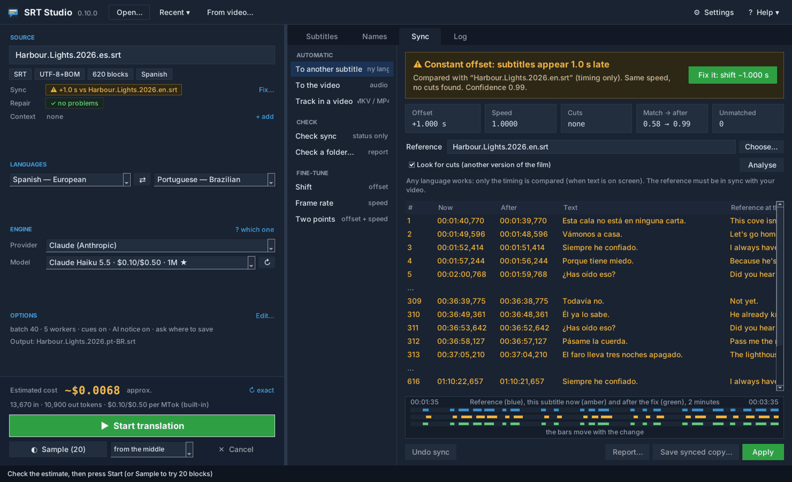
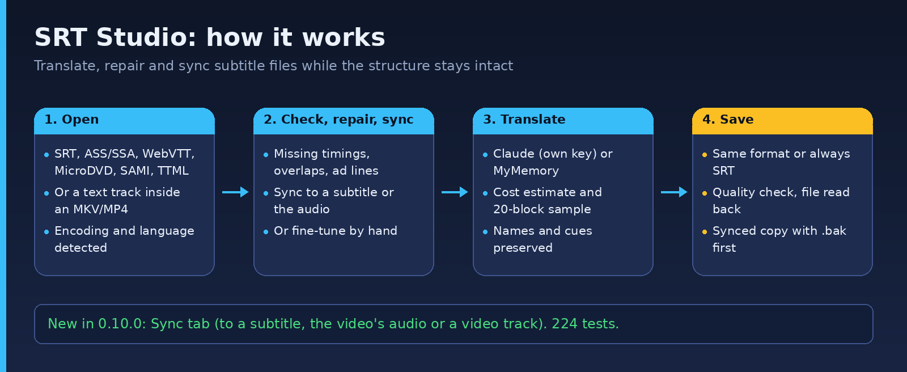

# SRT Studio

**Translate, repair and sync subtitle files (SRT, ASS, WebVTT and more), and take subtitles straight from MKV/MP4 videos.**
Formerly *SRT Translator* (renamed in v0.9.0).

[](LICENSE)  [](https://github.com/junqueirach/srt-studio/actions/workflows/ci.yml) 

<p align="center"></p>

**Download for Windows:** get the latest `SRT-Studio-<version>-win64.zip` from the [latest release](https://github.com/junqueirach/srt-studio/releases/latest). Unzip it, open the `SRT Studio` folder and double-click `SRT Studio.exe`. No Python needed. The SHA-256 checksum is in the release notes. For the Claude engine you need your own API key (see Quick start).

> **Windows SmartScreen:** the file is not code-signed, so Windows may show "Windows protected your PC". Click **More info**, then **Run anyway**. You can also run the app from source (see Quick start) and read every line of the code first.

## How it works

<p align="center"></p>

1. Open a subtitle (**Open…**, Ctrl+O, **Recent ▾**, or drop it on the window), or a video with **From video…** and pick one of its subtitle tracks. Format, encoding, language and block count are shown as small labels, and the file is checked for problems and for its timing.
2. If the **Repair** line shows problems, **Review…** lists them and **Repair** fixes them in the app. If the timing is off, the **Sync** tab fixes it (see *Sync* below).
3. Pick the target language, the provider and, for Claude, the model. Check the cost estimate; optionally run a 20-block **Sample** (from the busiest dialogue in the middle, or from the start).
4. Press **Start**. Blocks are translated in parallel batches, checked, repaired if needed and saved as `Movie.pt-BR.srt` (or `.ass`, `.vtt`… in the source's own format). A finish message shows the real cost.

## What it does

- **Every text subtitle format**: SRT, ASS/SSA (styles, positions and comments kept), WebVTT, MicroDVD, SAMI, TTML, MPL2/TMP. Output in the same format or always SRT. Picture subtitles (PGS `.sup`, VobSub) need OCR and are not supported
- **Source check and repair**: text without a timing line (kept, never dropped), unreadable or reversed timings, zero durations, overlaps, wrong order, bad numbering, and ad or credit lines such as "Subtitles by … www.OpenSubtitles.org". Repair works in memory; *Save repaired copy…* writes a `.bak` first when it replaces the original
- **Sync**: fix subtitles that appear too early or too late, drift (another frame rate) or were made for another cut of the film, automatically against another subtitle that is in sync (any language), against the **video's audio**, or against a subtitle track inside a video; or by hand (offset, frame rate, two points). Check one file or a whole folder. See *Sync* below
- **Subtitles inside videos**: open an MKV, MP4, MOV, WEBM or AVI and pick a text subtitle track to translate, to use as the sync reference or to save as a file (ASS tracks stay ASS). The video is never changed
- **"Translated by AI" notice**: a short block in the target language at the start of the output (on by default, text and duration configurable)
- **32 languages**, detected by alphabet first (Thai, Cyrillic, Greek, Hebrew, Arabic, Devanagari, Hangul, Kana, Han) and then by common words; "language ?" instead of a wrong guess
- Two engines: **Claude** (best quality, bring your own key) and **MyMemory** (free, for testing)
- **Structure-preserving**: timings and line counts are never touched, only text is translated, and the saved file is read back and verified
- **Live model list and live pricing** from Anthropic, cached for offline use, plus a local `pricing.json` override
- **Real cost** of every run from the API usage, next to the estimate, with the total for the subtitle (runs, samples, name detection)
- **Hearing-impaired cues**, **name preservation** (with auto-detect), optional **context file** (same film in another language)
- Output encoding: UTF-8 with BOM (default), UTF-8 without BOM, or the same as the source

## Quick start

```
python srt_studio.py
```

The first run offers to install the packages the app needs if they are missing (`requests`, `anthropic`, `pysubs2` for formats other than SRT, `tkinterdnd2` for drag and drop, `numpy` for sync, `webrtcvad-wheels` for sync to the audio). Or install them yourself:

```
pip install -r requirements.txt
```

Sync to the video and subtitles inside videos also need **FFmpeg**. It is not bundled: the first time a feature needs it, the app offers to download it (about 81 MB, checked against a fixed SHA-256, stored in `~/.srt_studio/tools/ffmpeg`) or lets you choose an `ffmpeg.exe` you already have. A copy on the PATH is found by itself.

For the Claude engine you need an API key from [console.anthropic.com](https://console.anthropic.com). Enter it in **⚙ Settings** or set the `ANTHROPIC_API_KEY` environment variable. The key is kept in `~/.srt_studio_config.json`, outside this repository, and is sent only to `api.anthropic.com`. On the first start after the rename, the settings of SRT Translator (`~/.srt_translator_config.json`) are imported once; the old file is left as it was.

## The window

| Part | What it does |
|---|---|
| Toolbar | **Open…**, **Recent ▾** (last 8 files), **From video…** (subtitle tracks inside a video), **⚙ Settings**, **Help ▾** (Help, Translation engines, Check for updates…, About). Click the logo for **About** (author, contact, GitHub, Reddit, licence). |
| Left side | **SOURCE**: file name, format / encoding / blocks / language labels, **Repair** status with **Review…**, optional **Context** file. **LANGUAGES**: source (detected) and target, ⇄ swaps them. **ENGINE**: provider and model (★ = the cheapest current model; hover for details). **OPTIONS**: a one-line summary with **Edit…** (batch size, workers, cues, save next to source, AI notice, sample from). At the bottom: estimated cost (**↻ exact** counts the real input tokens), **Start**, **Sample** and **Cancel**. |
| Divider | Drag it to make either side wider. When the window is resized, both sides keep their proportion. Double-click it, or Settings → General → Reset layout, to go back to the default. |
| Subtitles tab | One row per block: number, time, source, translation (filled during the run), ⚑ flag. Show *All / Flagged / Repaired*, search text or a number; the strip below shows the selected block in full. |
| Sync tab | Methods on the left: **Automatic** (To another subtitle, To the video, Track in a video), **Check** (Check sync, Check a folder…) and **Fine-tune** (Shift, Frame rate, Two points). On the right: one verdict with a **Fix it** button, the facts (offset, speed, cuts, match before → after), a preview of the new times and a timeline of the reference, the subtitle now and after the fix. **Apply** changes the times in the app, **Save synced copy…** writes a file (a `.bak` first when it replaces the original), **Undo sync** restores the times the file had, **Report…** shows what changed. |
| Names tab | One name per line; **Auto-detect names** (Claude); a `Movie.names.txt` next to the subtitle is loaded automatically. The list belongs to one subtitle: loading another file clears it, after asking to save names that are not saved yet. |
| Log tab | Batch progress, quality-control report, repair log, real cost and "estimate vs actual". **Save log…** writes it to a text file. |
| Status bar | What is happening, the progress bar, the last cost, and **Open folder** after a saved run. |
| Finish message | The saved file, flagged blocks, structure check, the cost of the run next to the estimate, the total for this subtitle and where the prices came from. If saving fails, it says why, shows the cost and offers **Save as…**. Can be turned off in Settings → Output. |
| Failure message | When a run cannot work (API key rejected, model not found, no connection, MyMemory daily limit) it stops at once: **no file is written and no AI notice is added**, and a *Translation failed* message says what happened and what to do. When only some batches fail, the file is saved and the message counts only the blocks that really changed; the others are named and marked ⚑. |
| Settings | **General**: API key, models and prices, the optional `pricing.json` (found / not present, Open folder), reset layout, dark title bar, check for updates at start (off by default), **video tools** (where FFmpeg is; Choose, Download, Check). **Output**: finish message, output format, encoding, AI notice, sync check when a file is opened. **Repair**: remove ad and credit lines, extra patterns. **Files**: where the settings file is. |
| Keyboard | Ctrl+O open · Ctrl+Enter start · Esc cancel · Ctrl+1/2/3/4 tabs · Ctrl+S save the log (Log tab) · F1 Help. |

## Quality control

After every run each block is compared with its source:

- text identical to the source (likely untranslated)
- missing or empty lines, lost formatting tags
- names from the preserve list that disappeared

Blocks with these problems are sent back to Claude once, in small groups. Whatever remains is listed in the Log and marked ⚑ in the Subtitles tab. A batch whose output was cut off by the token limit is split in half and retried automatically.

## Models and pricing

The app does not hardcode the model list. On start, and whenever you press ↻, it reads `GET /v1/models` and shows every current Claude model with its context size. The list is cached in the settings file so the app also opens offline.

Prices are resolved in this order:

1. `pricing.json` next to the app, if present (see `pricing.example.json`)
2. the official pricing page, downloaded once a day and cached
3. a built-in table, used only when both fail (the finish message then says the price may be out of date)

`pricing.json` format, prices in dollars per million tokens, keys are model family and version:

```json
{
  "haiku 5.5":  {"input": 0.10, "output": 0.50},
  "sonnet 5.5": {"input": 2.00, "output": 10.00}
}
```

Typical cost, measured on a 903-block, 90-minute documentary translated to Brazilian Portuguese with Claude Haiku 5.5: about two cents. Thinking is turned off, or effort set to low, on every model so no reasoning tokens are billed.

## Sync

The Sync tab compares timing only (when text is on screen), so the reference can be in any language.

- **To another subtitle**: a subtitle that is in sync with your video. The app finds a constant offset, a different speed (frame rate), cuts and inserted scenes (another version of the film) and uneven timing, and shows one verdict with a **Fix it** button. When the reference shares the line timing (the same file, or a translation that kept it), each line is aligned to its counterpart.
- **To the video**: the app finds where people speak in the audio track (the centre channel of 5.1 sound, where film dialogue is) and matches the subtitle to it. Reading the audio takes about 20–60 s for a film and is kept for the next time.
- **Track in a video**: a subtitle track inside an MKV or MP4 used as the reference.
- **Check sync / Check a folder…**: the same comparison, status only; nothing is changed.
- **Shift, Frame rate, Two points**: by hand, with a live preview.

A reference that does not belong to the film gives "? Cannot tell" instead of a wrong fix, and a fix with low confidence is never written without asking.

**Known limits** (measured on real films):

- Against the video's audio, offset and speed are found reliably; cuts, longer intros and inserted scenes only sometimes, because speech detection also reacts to music and effects. For another version of the film, sync to a subtitle of that version.
- Small random errors of single lines (±0.15–0.3 s) cannot be told apart from normal differences when the reference is a subtitle in another language; two good subtitles of the same film already differ by about 0.06–0.14 s per line.
- Picture subtitle tracks (PGS, VobSub) are listed but need text recognition (OCR), which is not supported.

## Hearing-impaired subtitles

Cue lines written as `[door slams]`, `(laughs)` or `APPLAUSE` are translated and keep their bracket or capital style. Untick *Translate hearing-impaired cues* (Options) to leave them untouched. Lines made only of punctuation, numbers or music notes are never sent for translation.

## Development

```
pip install -r requirements.txt pytest
python -m pytest tests -v
python tools/make_icon.py        # rebuilds assets/icon.ico and icon-small.ico from the drawing (needs Pillow)
```

`tests/test_sync.py` tests the sync engine on synthetic films (offsets, frame rates, cuts, intros, jitter), `tests/test_media.py` the FFmpeg helpers (download with a fake server, cancel, checksum, probe, track extraction). `tests/test_core.py` covers parsing (all formats), repair, the AI notice, language detection, naming, cues, tags, the glossary, the pricing parser, the cost estimate and ledger, the batch protocol with a fake client, and quality control. No API key or network is needed. The window tests skip on a machine without a display, the FFmpeg download tests run on Windows only, and the tests with a real FFmpeg run only when FFmpeg is installed.

## Project facts

- Built in small steps, from a command-line script (`archive/versions/srt_translator R0 (no GUI).py`) to the GUI in v0.6.0, the quality-control release v0.7.0, the one-screen redesign in v0.8.0, the fixes in v0.8.1, in v0.9.0 the new name, layout and icon, all text subtitle formats, source repair and the AI notice, in v0.9.1 honest failure reports, the About window and a polished window, and in v0.10.0 sync (to a subtitle, to the video's audio, to a track inside a video) and subtitles taken straight from videos
- `web-prototype/` holds an early React version of the interface
- Changes per version are in [CHANGELOG.md](CHANGELOG.md)
- The app is split into `srt_studio.py` (the window), `srt_sync.py` (timing and the matching engine, no window code) and `srt_media.py` (FFmpeg)

## Third-party software

- **FFmpeg** (downloaded on demand, never bundled): the LGPL build `n8.1.3` from [BtbN/FFmpeg-Builds](https://github.com/BtbN/FFmpeg-Builds), licensed under the **GNU LGPL v2.1 or later**. Its licence file is kept next to it in `~/.srt_studio/tools/ffmpeg`. FFmpeg is a trademark of Fabrice Bellard; see [ffmpeg.org](https://ffmpeg.org/legal.html).
- **webrtcvad** (speech detection, MIT), **numpy** (BSD), **pysubs2** (MIT), **tkinterdnd2** (MIT), **anthropic** and **requests** (Apache 2.0).

---

## Community and contact

- **Reddit:** [r/SRTStudio](https://www.reddit.com/r/SRTStudio/) — questions, ideas, show your results
- **Bugs and requests:** [GitHub issues](https://github.com/junqueirach/srt-studio/issues)
- **Email:** junqueira.ch@gmail.com
- **New versions:** [Releases](https://github.com/junqueirach/srt-studio/releases) (the app can check for you: Help ▾ › Check for updates…)

The same links are in the app under Help ▾ › About SRT Studio.

## How this was built

Built with **Claude (Anthropic)** as the coding partner. I wrote the requirements and the revision prompts, tested every build on real data, and decided what to fix next. The `archive/versions/` folder keeps every earlier release so the iteration history is visible.

**Security note:** the app stores any API keys you enter in a local settings file outside this repository. `.gitignore` excludes config and settings files so keys are never committed.

## Contributing and security

See [CONTRIBUTING.md](CONTRIBUTING.md) and [SECURITY.md](SECURITY.md). Bug reports and ideas are welcome through the issue templates.

## Licence

MIT. See [LICENSE](LICENSE).

## Author

Luiz Junqueira - [junqueira.ch](https://www.junqueira.ch) - [LinkedIn](https://www.linkedin.com/in/luizjunqueira/)
